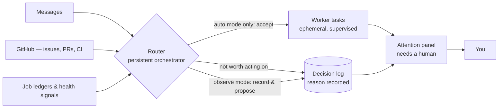

# Hermes Super Agent

**Stock Hermes is an agent you talk to. Super Agent turns it into an
operation that runs itself — and only interrupts you when a human is
actually needed.**

Super Agent is a layer that sits on top of [Hermes](https://github.com/NousResearch/hermes-agent)
(Nous Research) and adds the missing management structure: a persistent
orchestrator that watches everything your agent touches, decides what
matters, writes down every decision, and collects the handful of things
that genuinely need you into one panel.


## How it works



Stock Hermes has one loop: you talk, it answers, work lives and dies
inside the conversation. Super Agent adds the loop around it — intake,
triage, decision, supervision, escalation — so the conversation stops
being the system of record.

## Stock Hermes vs. Hermes + Super Agent

|  | Stock Hermes | With Super Agent |
|---|---|---|
| **Who's in charge** | Each chat session fends for itself | A persistent Router watches all of it, all the time |
| **How work arrives** | You type it into a chat | Messages, GitHub events, job-ledger events, and health signals are gathered and triaged for you |
| **How you learn something needs you** | You read the chat and notice | One attention panel lists everything waiting on a human |
| **"Why did it do that?"** | Scroll the transcript and guess | Every decision is written to a decision log, with its reason |
| **Who does the work** | The session you're talking to | Disposable worker tasks execute; the Router persists and supervises |
| **Automation risk** | The agent acts inside the conversation | Observe by default: it records and proposes. Acting on its own (`auto`) is a separate opt-in — never the default |
| **Outbound messages** | Sent directly, fire-and-forget | Queued in a durable outbox with retry/backoff (limits disclosed below) |

## From solo assistant to Super Agent

**Before:** a single conversational assistant. It executes tasks step
by step in your shared thread, stalls when a command runs long, and
fills the conversation with terminal logs and raw tool output until the
context window is the bottleneck. When the chat scrolls away, the state
of the work scrolls away with it.

**Operating as a Super Agent, the role shifts in four concrete ways:**

1. **Orchestrator over solo worker.** The agent you talk to becomes the
   coordinating front door. Instead of doing all heavy coding, audits,
   and research inside the active chat, it breaks high-level objectives
   into structured tasks, delegates them, and keeps the conversation
   responsive and clean. Results come back; the mess stays out.
2. **Decoupled, asynchronous execution.** Accepted work is dispatched
   to dedicated background workers (`sa-worker`) as kanban tasks. They
   run concurrently — on the author's stack, in isolated workspaces and
   worktrees — without blocking the chat or stalling when a command
   takes time.
3. **Effort routed by stakes.** Because work items are kanban tasks,
   each can carry its own model and reasoning settings (a stock Hermes
   capability the layer's tickets ride on). The operating pattern:
   fast, low-latency models for routing, status checks, and light
   coordination; top-tier reasoning at high effort reserved for
   high-stakes work — architecture audits, financial gates, production
   migrations.
4. **Structured state, not scrollback.** Work is tracked on disk as
   kanban cards with mandates, inspectable and resumable at any point.
   On the author's boards, cards carry completion contracts — unit
   tests, linting, spend ceilings (such as a $0.00 ceiling on read-only
   work) — that must pass before the work is reported back as finished.

## What it feels like to use

**Your morning check is one panel, not six chats.** Everything that
needs a human — a ticket stalled, a review waiting, a worker blocked —
collects in the attention panel, a read-only page in the Hermes web UI.
If it's not on the panel, it doesn't need you.

```
┌─ Attention — needs a human ─────────────────────────────┐
│  ●  Ticket blocked: export job failed twice             │
│  ●  Pull request waiting on your review                 │
│  ●  Worker task stalled — no progress in 40 minutes     │
└─────────────────────────────────────────────────────────┘
```
*Illustrative schematic. The shipped panel is a read-only page listing
real tickets from your own install; screenshots are on the punch list.*

**It is a proper orchestrator to subagents and to other persistent agents.** Signals don't wait
for you to open a chat. The Router continuously batches incoming
triggers from common sources such as GitHub, evaluates them against a versioned policy you control, and
records what it decided — ignore, propose, or (in auto mode only)
accept as a ticket with a mandate. Workers are spun up as kanban tasks
and torn down when done; the Router is the part that persists.

**Improved transparency.** The default posture is *observe*:
the layer watches, records, and proposes — it does not act. In its
first live verification, 118 incoming job events produced 116 written
decisions and **zero** auto-accepted tickets. Observe did exactly what
it promises. Turning on `auto` is a deliberate config change you make;
it is never a default and the installer never sets it.

**You can always audit it.** Every decision lands in a persistent
decision log. When the agent surprises you, the answer to "why" is a
record, not a transcript archaeology expedition.

## What you get

1. **Trigger intake** — inbound messages (scoped by the
   `superagent.pilot_surfaces` config key), GitHub issues/PRs/comments/
   CI/notifications, job-ledger events, and dispatcher/worker health
   signals, all feeding one queue.
2. **The Router** — a persistent orchestrator profile that triages the
   queue against your policy. It never does the work itself; it decides,
   delegates, and supervises.
3. **A decision log** — every triage outcome written down with its
   reason, whether the answer was "ignore," "recorded," or "accepted."
4. **The attention panel** — one read-only page of everything waiting
   on a human. (Acting on items happens through the API; the page
   itself has no action buttons.)
5. **A durable outbox** — outbound replies and notifications go through
   a persistent queue with retry/backoff state instead of being fired
   and forgotten.
6. **Disposable workers** — accepted work becomes ephemeral kanban
   tasks with mandates, so a bad worker never takes the manager down
   with it.

## Some changes you’ll notice

From the live install this package was cut from:

- **Cutover live 2026-11-03** on a Telegram pilot surface; the live
  install now runs in auto mode.
- **118 triggers → 116 recorded decisions, 0 auto-accepted** in live
  verification.
- **923 tests passing vs. 910 on the pristine stock baseline**, with an
  identical failure set — zero regressions.
- **Clean-room verified:** installed onto a pristine stock Hermes
  checkout, the resulting tree is byte-identical to the live integrated
  tree; uninstall restores a byte-identical pristine tree.
- **Secret/PII scanned** before publication (gitleaks + detect-secrets
  + manual review): zero true secrets, zero unadjudicated findings.

## Know before you install

- **This is a core patchset with a file-copy payload. It is not a
  plugin** — not a dashboard plugin, not a directory plugin, and not
  catalog-listable as one. The path to upstream is small enabling-hook
  PRs to Nous Research, proposed separately.
- **It ships off.** The installer sets `superagent.enabled=false` and
  `accept_mode=observe`, and refuses to run against a live Hermes
  install (`~/.hermes` or anything inside it). You install into a
  separate checkout and enable it yourself, deliberately.
- **Installing changes some stock behaviors even while the layer is
  disabled** — by design, and disclosed rather than hidden: kanban
  notifications and agent-originated cron deliveries are rerouted
  through the Super Agent outbox (which adds a dependency on the kanban
  database, with no direct-send fallback), and kanban workers lose 8
  toolsets at install time. The full list of known limitations lives in
  [`package/README-PACKAGE.md`](package/README-PACKAGE.md) — read it
  before installing.
- **Not in this version (never built):** panel screenshots.

## Install

```sh
cd package
sh install.sh /path/to/a-separate-hermes-checkout
```

Start with [`package/README-PACKAGE.md`](package/README-PACKAGE.md) for
the full package contents, removal, and the complete safety model.

## Repository layout

| Path | Contents |
|---|---|
| `package/` | The distributable: 11 core patches, the file-copy payload, tests, install/remove scripts, `SHA256SUMS`. |
| `docs/` | The build's phase reports, reviews, and decisions — provenance and history, not user documentation. |

Version of record: live stack branch `main` @
`bde1a3f598c1455da79156fe2356372e87b276b6`, diffed against baseline
`pre-superagent-cutover-20261103` @
`845b0755edea89d07ad6c62ba3e0927be8cd1444` (130 files, +39,682/−337).

## License / attribution

Hermes is MIT-licensed by Nous Research; that attribution is preserved
and nothing here changes it. Licensing of the Super Agent layer itself
is the author's decision.
